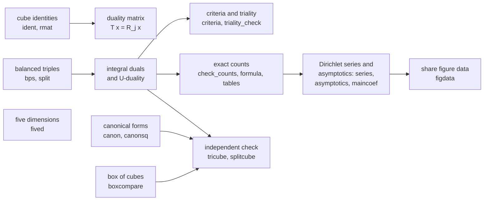

# Part I: STU black holes and Bhargava cubes

Code and computation logs for *Arithmetic of Freudenthal Duality I: STU Black Holes and Bhargava Cubes*.

An STU black hole charge is an integral 2×2×2 cube `x`, its quartic norm is `Δ = -Det(x)` (Cayley's hyperdeterminant), and its Freudenthal dual is `x̃ = sgn(Δ) T(x)/sqrt|Δ|`. The code decides, for every charge, whether `x̃` is integral and whether `x̃` lies in the U-duality orbit `SL2(Z)^3 · x`, and checks every count, Dirichlet series and asymptotic formula of the paper.



## What is checked

| Check | Range | Log |
|---|---|---|
| `Det(T(x)) = Det(x)^3`, `T(T(x)) = -Det(x)^2 x`, `Q_j(T(x)) = Δ Q_j(x)` | symbolic | `ident.log` |
| `T(x) = R_j ⋆_j x` with `R_j = [[-q_j, -2p_j], [2r_j, q_j]]` | symbolic | `rmat.log` |
| enumeration of balanced triples, integrality, U-duality | k ≤ 40, m ≤ 40 | `bps40.log`, `split12.log`, `split_more.log` |
| enumeration agrees with the closed formulas for F₊, E₊, F₋, E₋ | k ≤ 40, m ≤ 40 | `check_counts.log` |
| Bhargava-free canonical forms confirm every orbit and every decision | k ≤ 24, m ≤ 24 | `tricube24.log`, `splitcube24.log` |
| every orbit met by a cube with entries in [-2, 2] is accounted for | k ≤ 8, m ≤ 8 | `boxcompare.log`, `boxcompare_non.log` |
| explicit criteria (content k; `-Q_j ~ Q_j` and `gcd(x+x̃) = gcd(x-x̃)`) | k ≤ 24, m ≤ 16 | `criteria.log`, `nonbps_check.log` |
| triality criterion | m ≤ 16 | `triality.log` |
| Dirichlet series coefficients | k ≤ 40; m ≤ 2000 for E₋ | `formula.log`, `series.log`, `asymptotics.log` |
| partial sums against the residue main terms | up to 10^5 | `asymptotics.log`, `maincoef.log` |
| five-dimensional Jordan dual | \|q_i\| ≤ 40, n ≤ 30 | `fived.log` |
| explicit examples (Δ = 4, 256, 576, −1, −4, −25; D6–D2 family) | — | `explicit_examples.log`, `examples*.log`, `d0d6.log` |

The tables `logs/table_bps.txt` and `logs/table_non.txt` list the counts for k, m ≤ 24 (and m = 25, 32); `logs/counts.dat` and `logs/share.dat` hold the data of the figure on the proportion of U-dual pairs.

## Running

```sh
cd part1
sh run_all.sh
```

Python 3 with `numpy`, `sympy` and `mpmath`. All arithmetic is exact except the contour integrals for the residues (30 significant digits). The whole run takes under an hour on a laptop.

## Conventions

Cubes are listed as `(a0, ..., a7)` with `a_{4A+2B+C} = x_{ABC}`; `g ∈ SL2(Z)` acts on the j-th index by `(g ⋆_j x)_{..A..} = Σ_{A'} g_{AA'} x_{..A'..}`. The face forms are `Q_j(u, v) = -det(u M_j - v N_j)`, where `M_j`, `N_j` are the two slices of the cube with the j-th index fixed to 0 and 1. The triple product `T` is the cubic map of Borsten–Duff–Marrani, *Black holes and higher composition laws* (arXiv:2006.03574), eq. (2.50).
