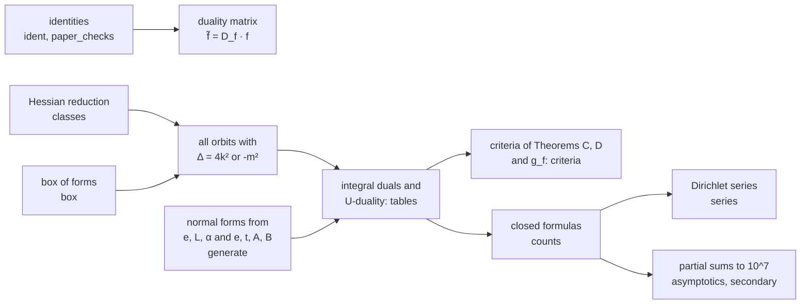

# Part II: the T³ model and binary cubic forms

Code and computation logs for *Arithmetic of Freudenthal Duality II: The T³ Model and Binary Cubic Forms*.

A T³ black hole charge is an integral binary cubic form `f = (a, b, c, d)`, that is `a u³ + 3b u²v + 3c uv² + d v³`, with charges `(p⁰, p, q, q₀) = (a, -b, c, d)`. Its quartic norm is `Δ = -Det(f)`, its Freudenthal dual is `f̃ = sgn(Δ) T(f)/sqrt|Δ|`, and the U-duality group is `SL2(Z)` acting by linear substitution. The code decides, for every charge, whether `f̃` is integral and whether `f̃` lies in the orbit `SL2(Z) · f`, and checks every identity, normal form, count, Dirichlet series and asymptotic formula of the paper.



## What is checked

| Check | Range | Log |
|---|---|---|
| Hessian and triple product covariance, `Det(T) = Det³`, `T(T(f)) = -Δ² f`, `h_T = Δ h`, syzygy `t² + Δ f² = 4h³`, `R_f · f = -Δ T(f)` | symbolic | `ident.log` |
| `R_f = -2 H_f J`, `det(2 H_f J) = Δ`, single-slot identity, `R_T = Δ R_f`, traces of `D_f ρ_f^j`, rotation formulas, worked examples, the constant `c₀` | symbolic; rotations at 200 random charges with 30 digits | `paper_checks.log` |
| enumeration of all orbits by Hessian reduction agrees with the closed formulas for F₊, E₊, F₋, E₋ | k, m ≤ 200 | `tables200.log`, `table200.txt`, `table.txt` |
| normal forms from the data `(e, L, α)` and `(e, t, A, B)` are pairwise inequivalent and exhaust the orbits with integral dual; contents, gcds and dual data as stated | k, m ≤ 40 | `generate.log` |
| U-duality criteria: content `k` for BPS; `h ~ -h` and `gcd(f+f̃) = gcd(f-f̃)` for non-BPS; `D_f` and `g_f` integral exactly for U-dual pairs, `g_f² = -1`; primitive Hessians only for Δ ∈ {4, -1, -4} | k, m ≤ 200 | `criteria.log` |
| completeness: every form with entries in [-30, 30] and Δ = 4k² or -m² lies in an enumerated orbit, with the same flags | k, m ≤ 40 | `box.log` |
| Dirichlet series coefficients | n ≤ 3000 | `series.log` |
| partial sums against the main terms, and the second terms from the poles at s = 2/3 and s = 1/3 | up to 10^7 | `asymptotics.log`, `secondary.log`, `counts.dat` |

`logs/table.txt` is Table 2 of the paper (n ≤ 40), and `logs/counts.dat` holds the data of Figure 3.

## Running

```sh
cd part2
sh run_all.sh
```

The full run takes about two minutes. Python 3 with `numpy`, `sympy` and `mpmath`. All arithmetic is exact except the evaluation of constants (30 significant digits).

## Conventions

A matrix `g` acts on forms by `(g · f)(w) = f(w g)` for row vectors `w = (u, v)`; in the code `act(g, f)` is this action. `hess(f)` returns the face form `(b² - ac, ad - bc, c² - bd)` of the triply symmetric cube, which is the Hessian `h_f(u, v) = (b² - ac)u² + (bc - ad)uv + (c² - bd)v²` evaluated at `(u, -v)`. In `generate.py` a BPS datum is written with `λ = iα`, so that `f = Im(λ ξ³) = Re(α ξ³)` and `f̃ = Im(α ξ³)`.
