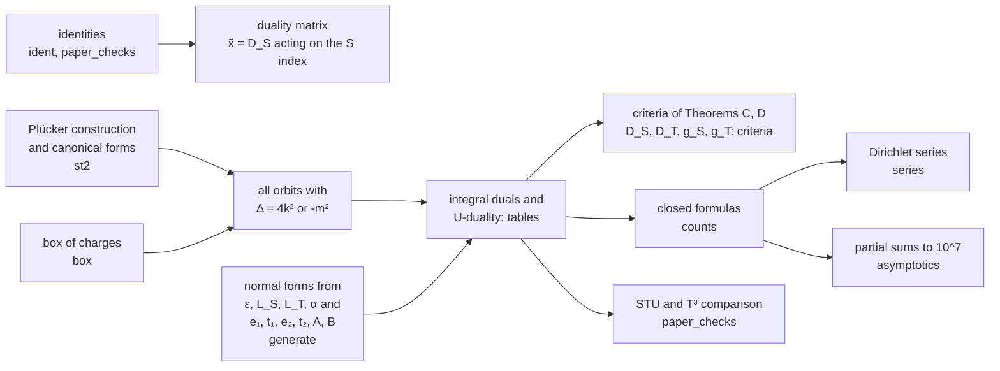

# Part III: the ST² model and pairs of binary quadratic forms

Code and computation logs for *Arithmetic of Freudenthal Duality III: The ST² Model and Pairs of Binary Quadratic Forms*.

An ST² black hole charge is a 2×2×2 cube symmetric in its last two indices, that is, a pair of classically integral binary quadratic forms `(a u² + 2b uv + c v², a' u² + 2b' uv + c' v²)`, with charges `(p⁰, pˢ, pᵀ, q₀, q_S, q_T) = (a, -a', -b, c', c, b')`. The U-duality group is `SL2(Z) × SL2(Z)`: the first factor acts on the pencil of the two forms (the S index) and the second by linear substitution of their variables (the two T indices). The code decides, for every charge, whether the Freudenthal dual `x̃ = sgn(Δ) T(x)/sqrt|Δ|` is integral and whether it lies in the orbit of `x`, and checks every identity, normal form, count, Dirichlet series and asymptotic formula of the paper, together with the comparison with the STU and T³ models.



## What is checked

| Check | Range | Log |
|---|---|---|
| covariance of the face forms `Q_S`, `Q_T`, `disc = -Δ`, invariance of the canonical form | 4000 random charges | `st2.log` |
| face forms as determinants, covariance of `Δ`, `Q_S`, `Q_T`, `T`; `Δ(T) = Δ³`, `T(T(x)) = -Δ² x`, `Q(T(x)) = Δ Q(x)`, syzygy, `R_S = -2 H_S J`, `R_S² = -Δ`, `T = R_S` on the S index, `T = R_T` on one T index, `(1, R_T) x = -Δ x` | symbolic | `ident.log` |
| explicit `T` and `Δ`, Plücker relation, `R_S(g x) = g₁ R_S g₁⁻¹`, the involution ι, the two real types, rank-one factorizations, stabilizers, real dualities and Freudenthal rotations, integral stabilizers and dualities, all worked examples, STU and T³ comparison | symbolic; 3000 random charges; 200 + 200 real charges at 40 digits; k ≤ 40; k, m ≤ 30 | `paper_checks.log` |
| enumeration of all orbits agrees with the closed formulas for h₊, F₊, E₊, h₋, F₋, E₋; each sign of `Q_T` carries half of the BPS orbits | k, m ≤ 200 | `tables200.log`, `table200.txt`, `tables.log`, `table.txt` |
| normal forms from the data `(ε, L_S, L_T, α)` and `(e₁, t₁, e₂, t₂, A, B)` are pairwise inequivalent and exhaust the orbits with integral dual; contents, dual data and U-duality as stated | k, m ≤ 40 | `generate.log` |
| U-duality criteria: `cont(Q_S) = k` for BPS, with `D_S` integral; `D_T` on one T index for `cont(Q_T) = k`; `Q_S ~ -Q_S`, `Q_T ~ -Q_T` and `gcd(x+x̃) = gcd(x-x̃)` for non-BPS, with `g_S`, `g_T` integral exactly then; primitive face forms only for Δ ∈ {4, -1, -4} | k, m ≤ 200 | `criteria.log` |
| completeness: every charge with entries in [-4, 4] and Δ = 4k² or -m² lies in an enumerated orbit, with the same flags | k, m ≤ 40 | `box.log` |
| Dirichlet series coefficients | n ≤ 3000 | `series.log` |
| partial sums against the main terms, second terms for E₊, h₊, E₋, the proportions s₊, s₋ and the STU share 2/(1 + ζ(3)/L(4, χ)) | up to 10^7 | `asymptotics.log`, `counts.dat` |

`logs/table.txt` is Table 3 of the paper (n ≤ 40), and `logs/counts.dat` holds the data of Figure 3.

## Running

```sh
cd part3
sh run_all.sh
```

The full run takes about ten minutes on one core. Python 3 with `numpy`, `sympy` and `mpmath`. All arithmetic is exact except the real checks (40 digits) and the evaluation of constants (30 digits).

## Conventions

In the code a charge is `s = (a, b, c, e, f, g)`, which is `(a, b, c, a', b', c')` in the paper. A pair `(g1, g2)` acts by `(g · x)(w₁, w₂, w₃) = x(w₁ g1, w₂ g2, w₃ g2)` for row vectors `w = (u, v)`; `act(g1, g2, s)` is this action and `act1(M, s, slot)` acts on one index only. Quadratic forms are triples `(P, q, R)` for `P u² + q uv + R v²`, and `QS(s)`, `QT(s)` are the face forms `-det x(w, ·, ·)` and `-det x(·, w, ·)`. The files `stu_canon.py` and `stu_canonsq.py` are the STU canonical forms of Part I, and `t3_cubic.py` and `t3_classes.py` the T³ tools of Part II, used for the comparison of the three models.
